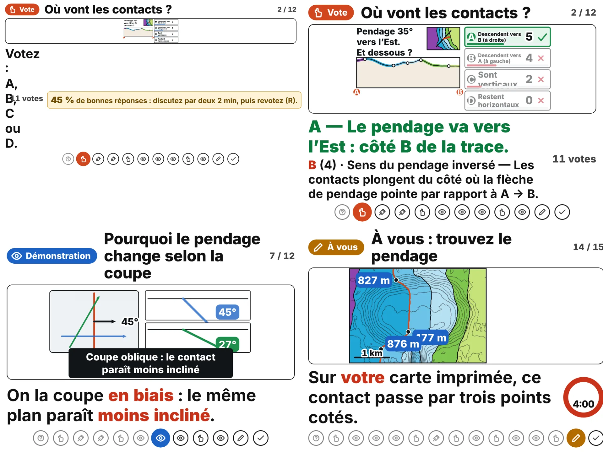

# GéoCarto v3.1 — « Raisonner, pas réciter » · plan de mise en œuvre

> Statut : **plan approuvé, implémentation non commencée** · version 1.0 · 2026-10-21
> Public visé : étudiants de première année de géologie, sans acquis en topographie, cartographie ni raisonnement géologique.
> Ce document évolue avec les versions : mettre à jour la section 9 (journal) à chaque jalon.

## 0. Principe directeur (non négociable)

**Quand la lisibilité depuis le dernier rang s'oppose à l'élégance technique ou à l'esthétique, la lisibilité gagne.**
GéoCarto doit devenir une plateforme d'**enseignement projeté** d'exception, pas seulement d'auto-apprentissage. Chaque lot ci-dessous est donc soumis au *contrat de lisibilité* de la section 2, vérifié par des mesures sur rendu réel.

## 1. Décisions validées

| # | Décision | Conséquence |
|---|---|---|
| D1 | Le **fil du raisonnement** et les **notes enseignant** associés sont un **premier jet à affiner** avec l'expérience de classe. | Tout ce qui est rédigé par la machine porte la mention visible **« brouillon automatique — à relire par un géologue »** jusqu'à relecture (§4, WP2 et WP6). |
| D2 | L'**ouverture sur la lecture du relief** est une **leçon préalable séparée** (`prereq`). | La durée de la leçon *Cartes géologiques* (≈ 38 min) n'augmente pas ; l'enseignant choisit de la passer ou non. |
| D3 | **Toutes les options de vote sont mélangées par défaut.** | Ordre fixe possible seulement si la pédagogie l'exige (`fixed: true`, justifié dans le code). |
| D4 | Ce plan est conservé dans `docs/V3_1_PLAN.md`. | Il évolue avec les versions. |
| D5 | **D (« Histoire d'une carte »)** reste le **prochain grand jalon** après v3.1 (= v3.2). | Hors périmètre de v3.1. |

Périmètre approuvé de v3.1 : **B** (fil du raisonnement) + **A** (options figurées) + **F** (préalable relief) + **I** (formations lisibles en projection), auxquels s'ajoutent deux lots rendus nécessaires par l'audit : **WP0** (ordre des options) et **WP1** (mise en page robuste en salle).

## 2. Contrat de lisibilité de v3.1

Chaque règle a un contrôle automatique ou une mesure sur rendu réel (Chromium, §7).

| # | Règle | Contrôle |
|---|---|---|
| L1 | Texte SVG ≥ `K.MIN` (3,4 u) ; texte HTML projeté ≥ 3,8 % de la hauteur d'écran (le bandeau d'en-tête est exclu, voir F5). | audit rendu |
| L2 | Budget d'attention : ≤ 3 points focaux et ≤ 12 mots par figure (un vote : autant de points que d'options). | `focus_report.mjs` (existant) |
| L3 | La couleur ne porte jamais seule (règle 5 de `STAGE_PEDAGOGY.md`). Éléments clés (flèches, traits) : contraste ≥ 3:1 sur chaque couleur de formation, ou liseré blanc. | `tests/palette.test.js` (nouveau) |
| L4 | Aucun texte hors de sa carte ; aucun recouvrement figure/bulle ; aucun rognage horizontal. | audit rendu |
| L5 | Sur un écran de vote, la figure garde **≥ 50 %** de la hauteur d'écran (≥ 45 % en 4:3) sur **toute la plage de réglage de salle** (×0,8 → ×2,5). | audit rendu (§7) |
| L6 | Une option figurée se distingue des autres de loin : écart ≥ 15° (ou de signe), traits ≥ 0,9 u, aucune étiquette sauf la lettre. | tests moteur + audit |
| L7 | Formations voisines distinguables sous projecteur délavé et daltonisme (ΔE ≥ 10) ou doublées d'un repère non coloré. | `tests/palette.test.js` |
| L8 | Pas plus de 4 séquences passives de suite ni 8 min sans action des étudiants (règle existante). | `tests/lessons.test.js` |

## 3. Constat de départ : audit visuel (2026-10-21)

**Méthode.** Les 27 scènes (15 *Cartes géologiques* + 12 *Coupes géologiques*), **chaque étape** (103 écrans, dont les 3 valeurs du paramètre d'échelle verticale), sur le code restauré. Rendu Chromium, animations terminées (1 s d'attente : une première passe à 110 ms avait produit de fausses « bulles pâles », écartées). Votes simulés (5 A, 4 B, 2 C, 1 D). Formats : 1920×1080, 1280×720, 1280×800, 1024×768 (4:3), 1280×1024 ; échelle de salle ×1 et ×1,5 ; balayage ×1 → ×2 sur le premier vote de chaque leçon. Chaque scène a été regardée sur une planche à 640×360 (ce qui simule aussi une vue lointaine). Les scripts d'audit n'étaient pas versionnés : WP7 les ajoute (`tools/stage/audit_geology.mjs`).
**Limites.** Écran d'ordinateur, pas projecteur réel : le délavé et la lumière ambiante sont simulés par calcul, pas mesurés en salle. Aucune mesure d'apprentissage.

### 3.1 Ce qui est solide et à préserver
- Aucun chevauchement de textes, aucun texte hors cadre, aucun défilement, **0 erreur JS** (103 écrans × 2 formats).
- Texte SVG minimal mesuré : 3,46 % (16:9) et 3,23 % (4:3) de la hauteur d'écran ; légende ≥ 4,9 %.
- Scénarisation visuelle : *coupe/1* (« Et sous le sol ? »), *coupe/6* (« Trois erreurs fréquentes » superposées en rouge), *geocarte/3* (légende = colonne du temps), *geocarte/7* (construction en trois points), *coupe/8* (échelle verticale paramétrée, 31° → 61°), bilans qui se terminent sur la réponse de la mission.

### 3.2 Défauts bloquants (mise en page en salle)

| ID | Constat | Mesure |
|---|---|---|
| **F1** | **À l'étape de décompte d'un vote, la figure s'effondre quand l'échelle de salle augmente** : le bandeau « bonnes réponses : discutez… » et le compteur, placés dans `.st-l-side` (`flex:none`, donc incompressible), s'élargissent avec `--u` et écrasent la légende en une colonne d'un mot par ligne ; le pied de page devient haut et la figure disparaît. Cause probable à confirmer en WP1. **Toutes les leçons** sont touchées (code partagé), pas seulement la géologie. | Hauteur de la figure, en % de l'écran (sain ≈ 55–70 %) : 16:9 → ×1 : 72 % · ×1,3 : 19–49 % · ×1,5 : 1–15 % · ×1,75 et plus : 1 %. 4:3 → ×1 : 61 % · ×1,1 : 38 % · ×1,5 : 8–15 % (la leçon *échelle* est encore plus bas : 26 % dès ×1, 0 % à ×1,1). Mesuré sur le premier vote de chaque leçon, étape de décompte. Le mode « amphi » s'active à ×1,3 ; l'interface propose jusqu'à ×2,5. |
| **F2** | En 4:3 / 5:4 avec échelle ×1,5, le texte des options déborde de sa carte (« Sont verticaux », « Restent horizontaux » coupés) et recouvre les barres de résultat ; à ×1 le texte touche déjà les barres (vu sur capture). | 10 écrans (4:3) et 13 (5:4) : *geocarte* 8 et 10, *coupe* 2, 5 et 9. |
| **F3** | Collisions figure/bulle : la bulle sombre de *coupe/7* (étapes 2 et 3) recouvre une partie du schéma et l'étiquette « 27° » (4:3, 5:4 et 16:10 ×1,5) ; *geocarte/14* : les étiquettes « 477 m » et « 876 m » se chevauchent (4:3 ×1,5) ; l'échelle « 1 km » coupe le trait de contact dans *geocarte/14* ; les bulles de *coupe/10* (étapes 1, 3, 4) mordent sur le bas de la coupe. | voir captures |
| **F4** | En 4:3 ×1,5, le compteur « n / N » et le minuteur de *geocarte/14* sont rognés à droite. | capture |

### 3.3 Défauts de lisibilité

| ID | Constat | Mesure |
|---|---|---|
| **F5** | Textes projetés sous 3,8 % : bandeau d'instruction par les pairs (2,8 %), compteur de votes (3,0 %), **chiffres du minuteur (2,9 %)**, libellé du paramètre (3,4 %), pastille de type de séquence et numéro de scène (2,6 %). Le minuteur concerne les étudiants (pratique) ; le bandeau est destiné à l'enseignant. | CSS `stage.css` : `.st-l-pi`, `.st-l-tally`, `.st-l-timer b`, `.st-l-pv`, `.st-l-n` ; audit |
| **F6** | Correction d'un vote : 23 à 44 mots (les 8 votes de géologie dépassent 22 mots), la seconde ligne (malentendu nommé) est à 3,5 %. | `coupe/5.2` : 44 mots |
| **F7** | La figure d'un vote est petite : l'encart de carte de *coupe/2* (flèche de pendage, information essentielle) ≈ 26×18 u ; la coupe erronée de *coupe/5* ; les cartes de *geocarte/13* et *coupe/9* — alors que leurs options tiennent en un mot et pourraient occuper moins de largeur. Les cartes d'options ont une largeur fixe (68 u sur 160). | observation |
| **F8** | **Flèches et traits clés sans liseré** : le rouge d'accentuation (`C.acc`, #d2461e) a un contraste de **1,29:1 sur le pourpre (Trias), 1,61:1 sur le bleu (Lias), 1,88:1 sur l'orange (Dévonien), 2,18:1 sur le vert (Crétacé inf.)** — moins de 3:1 sur 6 couleurs de formation sur 8 (la flèche « on marche dans le sens du pendage » traverse le pourpre ; le trait de contact et la direction de pendage sont aussi concernés). Les bulles, elles, sont bien contrastées (texte blanc : 4,5:1 à 18:1). | calcul WCAG (couleurs de `geology.js`) |
| **F9** | Espace perdu : *coupe/7* étape 0 et *geocarte/14* étapes 0-1 laissent environ 40 % de la figure vide (estimation visuelle) alors que la carte, dense en courbes, reste petite. Traits en plan de *coupe/7* fins. | observation |
| **F10** | Les formations estompées (opacité 0,22) deviennent presque blanches (*geocarte/3* étapes 2-3, *geocarte/11* étapes 1-2) : sous un projecteur délavé, les bandes « coupées » par le filon seront à peine visibles. | à mesurer (WP5) |
| **F11** | Teintes voisines peu distinctes : écart de couleur (ΔE76, CIELAB) Lias→Dogger 13,6 en vision normale ; **sous projecteur délavé (mélange de 40 % avec un gris clair) et daltonisme (deutéranopie, modèle de Machado), 3 paires passent sous 10** : Crétacé inf./sup. 8,3, Lias/Dogger 8,5, Ordovicien/Silurien 9,2 (Trias/Lias 10,4 et Dogger/Malm 11,9 sont à la limite). Visible dans *geocarte/12* (discordance : bleu intérieur et bleu de l'anneau). Simulation, pas mesure en salle ; seuil 10 = règle empirique. | calcul à reproduire dans `tests/palette.test.js` (WP5) |
| **F12** | Lettres grecques γ et δ dans les pastilles de légende (roches magmatiques) : lisibles de loin ? à tester avec des étudiants. | observation |

### 3.4 Observations pédagogiques à soumettre au géologue (hors périmètre v3.1)
- **P1.** Dans *coupe/4*, la formule α′ (δ = 35°, angle 30°, α′ = 31°) apparaît **avant** l'intuition visuelle de *coupe/7* (« pourquoi le pendage change selon la coupe »). *Intuition visuelle avant formalisme* : envisager d'inverser l'ordre ou de commencer *coupe/4* par une version sans formule.
- **P2.** La bonne réponse est **A dans 16 des 20 votes** de GéoCarto (les 8 votes de géologie sans exception) : corrigé par WP0.
- **P3.** *coupe/5* est déjà un vote de **diagnostic d'erreur** sur figure (la coupe d'un camarade) : c'est un bon modèle ; WP3 s'en inspire et l'agrandit plutôt que de le remplacer.

## 4. Lots de travail

Taille : S petite · M moyenne · L grande. Ordre d'exécution : WP0 → WP1 → WP2 → WP3 → WP4 → WP5 → WP6 → WP7 (WP4 et WP5 peuvent avancer en parallèle).

### WP0 — Ordre des options mélangé par défaut · S–M
- **But.** Supprimer le biais « la réponse est A » (P2) et rendre le décompte et les seuils de Mazur fiables.
- **Conception.** Permutation déterministe par (leçon, scène, graine de séance). Les décomptes restent stockés **dans l'ordre canonique** : journal, bilan (`pages.js`) et `diagnosis()` ne changent pas. La lettre affichée est convertie en index canonique à la frontière de l'interface (clavier a–d, clic, présentateur, `BroadcastChannel`). `fixed: true` pour les rares votes dont l'ordre porte du sens (justification obligatoire en commentaire).
- **Fichiers.** `js/stage/lesson.js` (`voteFig`, `vote()`, touches, légende de correction, vue présentateur), `js/stage/tools.js` (permutation).
- **Tests.** `tests/vote-order.test.js` : bijection, déterminisme, répartition de la bonne réponse sur A–D (≥ 15 % chacune sur 200 graines), cohérence lettre ↔ index canonique, `fixed` respecté. Le test des options (2 lignes de 17 caractères) reste vert.

### WP1 — Mise en page robuste en salle · M
- **But.** Corriger F1–F4 et L4–L5 : l'écran de vote doit rester lisible sur toute la plage d'échelle de salle et sur 16:9, 16:10, 4:3, 5:4.
- **Conception (lisibilité d'abord).** (1) Retirer le bandeau d'instruction par les pairs de l'écran projeté : il va dans la **vue présentateur** ; à l'écran il ne reste qu'un indicateur très court et gros (ex. « 42 % ») ou rien. (2) Plafonner `.st-l-side` (largeur maximale, `flex-shrink`) et garantir une **hauteur minimale de figure** (`min-height` de la rangée) ; le pied de page ne peut plus manger la figure. (3) Cartes d'options : hauteur adaptée au texte agrandi ou texte réduit par `K.fit` jusqu'à `MIN`, jamais de débordement. (4) Bulles : placées hors du cadre des schémas ou schéma réduit pour leur laisser la place (*coupe/7*, *coupe/10*) ; échelle « 1 km » éloignée des contacts. (5) Chiffres du minuteur ≥ 5 % ; compteur et numéro de scène à ≥ 3,8 %.
- **Fichiers.** `css/stage.css`, `js/stage/lesson.js`, `js/stage/kit.js` (`fit`), `js/stage/lessons/coupe.js`, `geomap.js`, `geologie.js` (positions de bulles).
- **Tests.** Audit rendu automatisé (WP7) sur 5 formats × échelles ×0,8 → ×2,5 : figure ≥ 50 % / 45 %, aucun texte hors carte, aucun recouvrement, aucun rognage ; ajout d'un test statique des sélecteurs (`css-scope`) pour toute nouvelle règle.

### WP2 — Fil du raisonnement (B) · M — *brouillon automatique, à relire*
- **But.** Rendre visible, à chaque scène, **comment pense un géologue** : un seul fil, le même pour les cartes et les coupes.
- **Conception.** Six jalons, **Observer · Situer · Mesurer · Dater · Supposer · Vérifier** (libellés ≤ 10 caractères). Bandeau HTML hors du SVG (n'ajoute aucun point focal), jalon courant plein **et numéroté** (pas la couleur seule), taille ≥ 3,8 %. Nom de classe `st-l-thread` : **`st-l-rail` désigne déjà les pastilles de navigation**. La leçon *Coupes* aboutit à **Vérifier** : une coupe est le *test d'une hypothèse*, pas un dessin à recopier. Fiche A5 imprimable (`#/stage/fil`).
- **Correspondance scène → jalon (version 0, à affiner).** *Cartes* : hook, v1, légende → Observer ; contact, horiz, v2 → Situer ; dip, v3, pr → Mesurer ; âge, v4, recoup → Dater ; struct, v5 → Supposer ; bilan → les six. *Coupes* : hook → Observer ; v1, horiz, mono → Vérifier ; v2 (erreurs), apparent, ev → Mesurer ; struct, v3 → Supposer ; pr → Vérifier ; bilan → les six.
- **Statut.** Champ `draft: true` sur chaque jalon et chaque texte ; mention **« brouillon automatique — à relire par un géologue »** visible dans la vue présentateur et la fiche imprimable (clé i18n `lk.draft`). Retirer le drapeau = relecture faite (nom du relecteur et date dans ce document, §9).
- **Fichiers.** `js/stage/lesson.js`, `js/stage/lessons/geologie.js` et `coupe.js` (champ `step`), fichiers de textes des leçons, `js/stage/pages.js` (fiche), `js/main.js` (route, à vérifier), `css/stage.css`.
- **Tests.** `tests/thread.test.js` : chaque scène de géologie a un `step` valide ou un `null` justifié ; ordre non décroissant dans une leçon ; clés i18n présentes ; libellés ≤ 10 caractères ; le bandeau n'émet aucune classe `fp` ; tout jalon `draft` affiche la mention.

### WP3 — Options figurées (A) · L
- **But.** Chaque mauvaise réponse est **la figure que produirait un étudiant ayant ce malentendu**, générée par le moteur : le vote *diagnostique* et la salle *voit* pourquoi c'est faux.
- **Moteur.** Nouveau module pur `js/engine/geology/distractors.js` (sans DOM, contrat des moteurs respecté) : sens inversé, contacts verticaux, contacts horizontaux, pendage vrai pris pour l'apparent, contacts en éventail. Additif : les golden et `ENGINE_VERSION` ne changent pas.
- **Deux mises en page de vote.** `gallery` (grille 2×2 de mini-figures, lettre seule) et `overlay` (une carte, quatre flèches lettrées ; les cartes de texte restent). Largeur des cartes **adaptative** : options d'un mot → cartes étroites → figure plus grande (F7).
- **Première série (4 des 8 votes de géologie).** *coupe* v1 (sens, vertical, horizontal) et v3 (voûte/cuvette) en `gallery` ; *geocarte* v3 (direction du pendage) en `overlay` ; *coupe* v2 (diagnostic d'erreur, déjà figuré) : **agrandi seulement**. Les votes *couleur*, *âge*, *horizontales* et *nom de structure* restent verbaux (pas purement géométriques).
- **Fichiers.** `js/engine/geology/distractors.js` (+ `index.js`), `js/stage/lesson.js`, `js/stage/lessons/coupe.js`, `geologie.js`, `geosection.js`, `geomap.js`, fichiers de textes, `css/stage.css`.
- **Tests.** Propriétés dans `tests/engine.test.js` (variante correcte = `apparentDip`, écart ≥ 15° ou de signe, toutes structures × graines) ; dans `tests/geology-stage.test.js`, chaque option figurée correspond à l'identifiant de malentendu annoncé ; budget d'attention ; audit rendu.

### WP4 — Leçon préalable « Lire le relief » (F) · M
- **But.** Vérifier en 3 votes (≈ 6 min) que les étudiants lisent les courbes de niveau avant d'aborder les contacts.
- **Conception.** Leçon **séparée** `prereq`, entièrement active (votes). Réutilise les malentendus existants (`e-diff`, `e-bas`, `t-fermee`, `t-vallee`…) et ajoute la question du **V d'une courbe dans une vallée** (pont vers la règle des V). Conseil par bande de Mazur **dans la vue présentateur**. Lien depuis l'accroche de *Cartes géologiques*.
- **Fichiers.** `js/stage/lessons/prereq.js` (nouveau), `lessons/index.js`, `lessons/fr.js`, `tests/lessons.test.js` (le test « 11 thèmes » admet les leçons annexes).
- **Tests.** `tests/prereq.test.js` ; tests existants (budget, options, séquences passives).

### WP5 — Formations lisibles en projection (I) · M
- **But.** F8, F10–F12 : la géologie ne repose plus sur la couleur seule ni sur un rouge invisible.
- **Conception.** (1) **Lettre de formation sur chaque région** et **hachures** pour les paires faibles (le choix visuel final se décide sur rendu, pas sur plan). (2) **Liseré blanc** sous toutes les flèches et tous les traits clés ; épaisseurs minimales relevées. (3) Opacité des formations estompées ≥ 0,35 (à valider) avec contacts conservés. (4) Greek γ/δ : lettres latines ou pictogramme à tester.
- **Fichiers.** `js/stage/lessons/geomap.js` (`geoMapSvg`, `legendSvg`), `geosection.js` (`regionsSvg`), `geoworld.js`, `css/stage.css`.
- **Tests.** `tests/palette.test.js` : contraste ≥ 3:1 des éléments clés sur chaque formation (ou liseré présent), ΔE ≥ 10 des paires voisines (ou repère non coloré) sous délavage et daltonisme (les formules du calcul de l'audit).

### WP6 — Couche enseignant minimale · S — *brouillon automatique, à relire*
- **Constat.** La vue présentateur lit `<leçon>.<scène>.note` et `.ask`, mais **les scènes de géologie n'en ont aucune** (0 note, 0 question) : la vue affiche « — ».
- **Contenu.** Pour les scènes modifiées ou créées en v3.1 : note, question à poser, conseil par bande de Mazur (< 30 %, 30–70 %, > 70 %). Chaque texte porte `draft: true`.
- **Tests.** Chaque scène de vote touchée a `note` et `ask` ; la mention « brouillon » s'affiche.

### WP7 — Outil d'audit et hygiène de livraison · S
- Ajouter `tools/stage/audit_geology.mjs` (dérivé de l'audit de la section 3 : captures de toutes les étapes, votes simulés, formats × échelles, sondes de débordement et de recouvrement), utilisable en local et en intégration continue (Chromium présent).
- Changer le nom de cache de `sw.js`, reconstruire `dist/app.js` (`npm run check:dist` vert), mettre à jour `README.md`, `docs/ENGINES.md` (nombre de tests) et ce document.

## 5. Impact par fichier

| Fichier | Lots |
|---|---|
| `js/stage/lesson.js` | 0, 1, 2, 3 |
| `js/stage/tools.js` | 0 |
| `js/stage/kit.js` | 1 |
| `js/stage/lessons/geologie.js`, `coupe.js` | 1, 2, 3, 5, 6 |
| `js/stage/lessons/geomap.js`, `geosection.js`, `geoworld.js` | 1, 3, 5 |
| `js/stage/lessons/prereq.js` (nouveau), `index.js`, `fr.js` | 4 |
| `js/engine/geology/distractors.js` (nouveau), `index.js` | 3 |
| `js/stage/pages.js`, `js/main.js` | 2 |
| `css/stage.css` | 1, 2, 3, 5 |
| `tests/` : `vote-order`, `thread`, `prereq`, `palette` (nouveaux) ; `engine`, `geology-stage`, `lessons` (étendus) | 0, 2, 3, 4, 5 |
| `tools/stage/audit_geology.mjs` (nouveau), `sw.js`, `dist/app.js`, `README.md`, `docs/` | 7 |

## 6. Hors périmètre de v3.1 (reporté)
**D — Histoire d'une carte** (dépôt → basculement → érosion → vue du dessus) : **jalon v3.2**, il partagera le moteur de bloc 2D avec **C** (vues liées carte ⇄ coupe ⇄ bloc, en SVG ; pas de WebGL tant que les projecteurs d'amphi ne sont pas testés). Aussi reportés : mode évaluation et fiches imprimables, vote sur téléphones, arabe et anglais, cas marocains relus, cartes géologiques réelles (licences), P1 (ordre formule/intuition).

## 7. Plan de test et critères d'acceptation

1. La suite existante (122 tests) reste verte ; `npm run check:dist` vert ; CI verte.
2. Nouveaux tests : `vote-order`, `thread`, `prereq`, `palette` ; extensions `engine`, `geology-stage`, `lessons`.
3. **Audit rendu** (WP7) : 27 scènes × toutes les étapes × 5 formats × échelles ×0,8 → ×2,5 : aucun défaut F1–F4 ; texte ≥ 3,8 % hors bandeau d'en-tête ; figure de vote ≥ 50 % (≥ 45 % en 4:3).
4. **Revue visuelle** de chaque scène modifiée, planche à 640×360 comme simulation de vue lointaine.
5. **Revue du contenu** : relecture par un géologue des règles, de la correspondance des jalons et des notes (D1). Tant qu'elle n'a pas eu lieu, la mention « brouillon automatique » reste affichée.
6. **Essai en salle** (une séance réelle) : journal local des votes ; observation de la répartition des réponses avant/après WP0 et WP3. **Descriptif seulement** : aucune conclusion sur les acquis sans un protocole (pré/post, approbation éthique).
7. **Non vérifiable ici** : contraste d'un vrai projecteur, effet pédagogique, relecture géologique. À dire dans les notes de version.

## 8. Risques et décisions ouvertes
- **Relecteur géologue** (nom, date) : à désigner ; sans lui, tout reste « brouillon ».
- **WP1 touche tout le mode Stage**, pas seulement la géologie : prévoir un essai sur les autres leçons.
- **Options figurées** : la densité visuelle (4 mini-figures) doit rester lisible ; critère L6 ; arbitrage sur rendu.
- **Hachures vs lettres** (WP5) : à trancher sur capture projetée.
- Le dépôt de reprise `recovery/restore-source` doit être fusionné avant d'empiler v3.1.

## 9. Journal
| Date | Événement |
|---|---|
| 2026-10-21 | Plan v1.0 rédigé après audit visuel des 27 scènes (103 écrans) ; décisions D1–D5 enregistrées. Aucun code modifié. |
